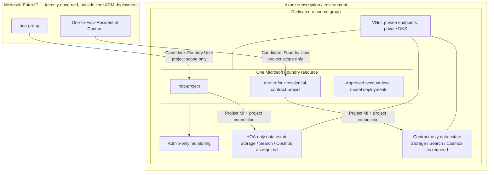

# Canonical Integrated Project Plan

**Project owner:** Carol Garcha  
**Architecture reviewer:** Danny, Lead / Solution Architect  
**Date:** 2026-07-31  
**Status:** **Approved with conditions — planning baseline only**  
**Canonical precedence:** This document resolves planning conflicts. Detailed artifacts remain authoritative for their specialist detail unless they conflict with this plan or a locked decision.

## 1. Executive outcome

Plan one Microsoft Foundry resource in `northcentralus`, subject to live capability validation, with two child projects:

- `hoa-project`, assigned to `hoa-group`
- `one-to-four-residential-contract-project`, assigned to `One-to-Four-Residential-Contract`

Each project is a planned isolated document-extraction and quality-control workspace. Each developer group is a candidate for the built-in **Foundry User** role at only its matching project scope. Project-specific managed identities, customer-data connections, and backing data resources are designed to prevent intentional sharing. Private endpoints and private DNS provide the planned network path.

The design is approved **with conditions** because strict sibling-project non-discoverability, project-scoped authoring capability, `northcentralus` feature availability, and source-authority/Responsible AI inputs are not yet proven in a live tenant.

## 2. Scope, non-goals, assumptions, and locked decisions

### 2.1 In scope

- Architecture, identity/RBAC, networking, data-boundary, Bicep, validation, domain, privacy, and Responsible AI planning.
- Document intake, field extraction, normalization, provenance, confidence, contradiction/missing-data detection, and human-review routing.
- Synthetic or approved public specimen data for validation.
- Repeatable deployment and evidence requirements.

### 2.2 Non-goals

- No implementation code or resource provisioning in this planning phase.
- No autonomous approval, denial, pricing, underwriting, eligibility, or credit decision.
- No legal interpretation, legal advice, or compliance certification.
- No live borrower, property, HOA, employee, or customer data.
- No secrets, credentials, raw tokens, UPNs, or PII in the repository.
- No guarantee that one Foundry resource can satisfy strict sibling non-discoverability.

### 2.3 Locked decisions

| Decision | Canonical value |
|---|---|
| Foundry resources | Exactly one account containing both projects in the target deployment; no per-project account split |
| Projects | `hoa-project`; `one-to-four-residential-contract-project` |
| Entra groups | `hoa-group`; `One-to-Four-Residential-Contract` |
| IaC | Bicep |
| Isolation | Strict sibling-project non-discoverability is a deployment gate |
| Use boundary | Document extraction and quality control only |
| Networking | Private endpoints, private DNS, public access disabled |
| Data | Project-specific customer-data connections and data estates |
| Region | `northcentralus`, pending live validation |
| Domain authority | Sources, jurisdictions, form versions, standards, and approvers TBD |

### 2.4 Assumptions requiring proof

- The selected Foundry project, agent, evaluation, model, and private-network features are available in `northcentralus`.
- Project-scoped Foundry User is sufficient for the selected agent and evaluation authoring paths.
- A user can operate the assigned project without parent Reader and without sibling metadata disclosure.
- Project managed identities can receive sufficient permissions without account-wide sibling access.
- A private extraction path can be implemented without relying on network-isolated File Search.

## 3. Evidence classification

| Classification | Meaning |
|---|---|
| **Documented platform behavior** | Supported by current Microsoft documentation and suitable as a design input. |
| **Live tenant validation required** | Must be demonstrated in the selected tenant/subscription, region, portal/API path, feature version, and policy environment. |
| **Deployment gate** | Failure stops release and requires a design decision; it must not be described as guaranteed behavior. |

Key classifications:

- Projects are documented access/development boundaries for project assets.
- Azure RBAC inheritance is documented: project assignments cannot remove access inherited from a parent.
- Foundry User at project scope is a **candidate**, not approved proof of agent/evaluation authoring for the selected features.
- Strict sibling non-discoverability is a **deployment gate**, not documented guaranteed platform behavior.
- `northcentralus` support documentation is not proof of model capacity, quota, private-network compatibility, or tenant policy acceptance.

## 4. Canonical topology

### 4.1 Resource and project topology

- Deploy one Foundry account with project management enabled.
- Create exactly the two locked project children with system-assigned managed identities.
- Keep account-level model deployment and governance under administrator control.
- Do not create shared account-level customer-data connections.
- Use separate project Storage, Azure AI Search, and Cosmos DB resources when required by the approved agent pattern. Omit an unused service only after capability validation; do not replace separate stores with shared stores for convenience.
- Permit an admin-only shared monitoring destination only when project attribution is retained and project groups cannot view sibling telemetry.

### 4.2 Data and connection topology

- Create only project-scoped managed-identity/AAD connections.
- Bind each project identity only to its own data estate.
- Do not use account keys, SAS, client secrets, passwords, or shared customer-data credentials.
- Keep files, datasets, indexes, agent state, evaluation data, and document corpora project-specific.
- Cross-project references, if approved by the domain process, carry opaque reference IDs only; they do not copy raw content or field sets.

### 4.3 Network topology

- Disable public network access where supported.
- Use one Foundry account private endpoint plus separate private endpoints for each project backing resource.
- Link the required private DNS zones for Foundry and deployed backing services.
- Provide approved private access for developers, CI, agents, and evaluation runtimes.
- Treat account-wide VNet injection as shared network reachability. Identity, connections, and service data-plane RBAC must still prove project isolation.
- File Search is not assumed available in the network-isolated design. The private extraction/tool path is selected during live preflight.

## 5. Identity, RBAC, and strict isolation

### 5.1 RBAC matrix

| Principal | Candidate/required access | Explicit exclusions |
|---|---|---|
| `hoa-group` | Candidate Foundry User at `hoa-project` only | No parent, sibling, backing-resource, monitoring, or IAM role |
| `One-to-Four-Residential-Contract` | Candidate Foundry User at contract project only | No parent, sibling, backing-resource, monitoring, or IAM role |
| HOA project managed identity | Minimum project role and data roles on HOA resources only | No contract project/data access |
| Contract project managed identity | Minimum project role and data roles on contract resources only | No HOA project/data access |
| Foundry administrators | PIM-eligible Foundry Account Owner at the account | No routine project-group membership or data access |
| Infrastructure CI identity | Federated Contributor at the environment resource group | No role-assignment, Graph, or Foundry data permission |
| Access CI identity | Federated RBAC administration only at approved exact scopes | No Contributor, Graph, or project data permission |
| Bootstrap operator | Time-bound approved bootstrap permissions | No standing elevation |
| Break-glass identities | Emergency access under tenant policy | Never used as isolation-test identities |

### 5.2 Binding caveat

**A project-scoped assignment cannot remove inherited parent access.** Direct, nested/transitive group, PIM eligible/active, management-group, subscription, resource-group, Foundry-account, Lighthouse, classic-administrator, custom-role, and service-managed assignments must be audited. A deny assignment is not accepted as compensation for an unintended broader allow.

Parent Reader is not approved for project groups. If portal authoring requires it or exposes a sibling name, ID, count, URI, tag, recent item, picker entry, error detail, or other metadata, strict non-discoverability fails. The allowed resolution paths are:

1. retain API/SDK-only authoring if Carol accepts it; or
2. reopen the locked one-resource topology.

Do not silently weaken “not discoverable” to “cannot modify.”

### 5.3 Capability qualification

Foundry User GUID `53ca6127-db72-4b80-b1b0-d745d6d5456d` is the documented least-privilege candidate. It is accepted only after live tests prove, for both projects:

- prompt-agent create/read/update/delete/invoke;
- approved file/dataset use;
- evaluation create/run/read/delete;
- approved model inference;
- denial of project creation, model deployment management, networking, keys, and role assignment;
- zero sibling discovery or access.

## 6. Loan, HOA, and contract domain workstream

### 6.1 Permitted output

Agents may extract and normalize:

- borrower/party, property, transaction/contract, loan terms, income/employment, assets/liabilities, declarations/consents, HOA facts, and dates;
- source document/page/section, extraction method, confidence, validation status, escalation reason, human-review role, and last verification time;
- calculated values only when formula and inputs are retained.

Every value must be tagged as one of:

1. application field;
2. document-derived fact;
3. calculated value; or
4. analyst/legal conclusion.

Agents never populate category 4. They route an unresolved question to an approved human role.

### 6.2 Project workstreams

- `hoa-project`: declarations/CC&Rs, bylaws, rules, budgets, assessments, resale/status certificates, insurance, litigation, meetings, management details, and jurisdiction-specific equivalents.
- `one-to-four-residential-contract-project`: parties, property, price/earnest money, financing, title/survey, inspections, disclosures, HOA addenda references, closing/possession, prorations, defaults/remedies, notices, signatures, deadlines, and form metadata.

### 6.3 Source-authority gate

Production schema, requiredness, staleness, tolerance, and acceptance rules remain blocked until Carol names:

- jurisdictions and counties;
- authoritative contract publishers, forms, and versions;
- authoritative HOA source corpus/vendors;
- canonical loan-field standard, such as MISMO or an internal LOS schema;
- human legal, HOA, fair-lending, TRID, data-governance, and incident approvers.

Until then, jurisdiction/form-dependent rules default to `unknown — human-review-required`. Industry HOA references are discovery aids, not authoritative compliance sources.

## 7. Responsible AI, privacy, and safety controls

Rai’s reviewer verdict remains **🟡 Yellow — advisory/blocked pending inputs**. No critical planning violation was found, but Yellow is not approval for real data or production.

### 7.1 Hard controls

- Extraction/QC-only boundary; no autonomous high-stakes or legal/compliance conclusions.
- Field classification: `public`, `internal`, `confidential-PII`, `confidential-financial`, or `restricted-protected-class`.
- Data minimization, redacted logs/traces, synthetic test data, and approved retention.
- Full provenance/category/confidence/review metadata for each output.
- Mandatory escalation for missing, ambiguous, contradictory, stale, altered, low-confidence, or prohibited-use cases.
- Protected-class fields are verbatim extraction only for the approved reporting purpose and cannot affect another field’s extraction, confidence, validation, or routing.
- Treat document content as untrusted input; embedded instructions cannot alter agent behavior.
- Zero cross-project corpus, index, context, state, connection, citation, or canary leakage.
- Pause/rollback triggers for prohibited outputs, protected-class misuse, successful injection, fabricated facts, or cross-project leakage.

### 7.2 Threshold reconciliation

Numeric extraction and calibration targets in the detailed plans are **provisional candidates**, not production commitments. Absolute gates remain binding: zero fabricated critical facts, zero prohibited conclusions, zero protected-class misuse, zero successful instruction injection, and zero cross-project leakage. Final accuracy, completeness, staleness, tolerance, confidence, and escalation thresholds require authoritative sources, representative governed data, calibration, and named human approval.

No agent may process real borrower/property data until all hard controls are implemented and all required human roles are named.

## 8. Bicep and Entra provisioning boundary

- Core Azure Bicep/ARM does not natively own Microsoft Entra group lifecycle.
- The Microsoft Graph Bicep extension is a separate Graph control plane with separate permissions and lifecycle. It is not part of the recommended core deployment.
- The identity-governance process pre-provisions the exact groups and supplies immutable object IDs.
- A pre-deployment Graph read verifies each object ID, exact display name, security-enabled/mail-disabled state, membership type, and owners.
- Bicep consumes `hoaGroupObjectId` and `contractGroupObjectId`; it performs no display-name discovery and creates no groups through deployment scripts.
- Keep bootstrap, infrastructure, and access deployments and identities separate.
- Use deterministic role-assignment IDs and only non-secret inputs/outputs.

Recommended future entry points:

1. subscription bootstrap;
2. resource-group infrastructure;
3. project managed-identity/backing-resource access;
4. human/group RBAC access.

## 9. Phased roadmap

Effort ranges are engineering estimates after required access is available. They exclude procurement, quota lead time, policy exceptions, and business/legal approval.

| Phase | Owner(s) | Dependencies | Concrete deliverables | Review gate | Rough effort |
|---|---|---|---|---|---|
| P0 — Input and authority closure | Carol, Danny, domain/RAI approvers | Plan approval | Tenant/subscription, environment classification, network owner, feature set, sources/forms/standards, named approvers, retention and review policies | G0: required decisions recorded; unresolved items explicitly blocked | 1–3 days of team effort; external lead time TBD |
| P1 — Live tenant/capability preflight | Rusty, Livingston, Basher, tenant admins | P0 minimum Azure inputs | Provider/API/role snapshots, region/model/evaluator/quota matrix, private-link/DNS findings, policy findings, candidate extraction path, portal/API permission probes | G1: feasible feature/API/network/RBAC contract; no unsupported claim promoted to fact | 1–3 days |
| P2 — Bicep implementation | Basher, Livingston, Rusty | G1; group object IDs; network contract | Bootstrap, network/DNS, per-project data, Foundry/projects, connections, diagnostics, MI access, group access, typed parameters/outputs, CI assertions | G2: lint/build/validation and reviewed what-if satisfy exact topology and scopes | 7–14 days |
| P3 — Controlled validation deployment | Basher, tenant/network admins, Linus | G2; isolated validation environment | One account/two projects deployment, private endpoints/DNS, no-change what-if, rollback evidence, sanitized inventory | G3: private-only connectivity, no public/key bypass, idempotent deployment | 2–4 days |
| P4 — Capability and isolation proof | Linus, Livingston, Rusty, Danny | G3; clean test identities; fresh-token process | Effective-access audit; portal/ARM/API/SDK positive and negative matrix; project-MI backing-resource tests | G4: own-project authoring works; G5: zero sibling discovery/access | 3–6 days |
| P5 — Domain and RAI evaluation | Reuben, Rai, Linus, named approvers | Source-authority gate; approved synthetic/gold corpus; G3 | Versioned HOA/contract schemas, functional/adversarial suites, threshold calibration, redacted evidence | G6: domain/RAI hard gates pass and approvers accept calibrated rules | 4–8 days |
| P6 — Production-readiness decision | Danny, Carol, all owners | G4–G6 | Consolidated evidence pack, residual-risk decisions, operating/RACI runbook, go/no-go record | G7: definition of done met | 1–3 days |

P4 and P5 may run partly in parallel after P3, but production readiness requires both.

## 10. Requirements traceability

| ID | Requirement | Plan location | Acceptance evidence |
|---|---|---|---|
| ARCH-01 | One Foundry resource and exact two projects | §§1, 4 | Compiled template, what-if, deployed inventory |
| ID-01 | Exact two Entra groups | §§2, 8 | Identity-governance record and object-ID verification |
| RBAC-01 | Candidate Foundry User only at matching project scope | §5 | Live role snapshot, role assignments, positive capability tests |
| ISO-01 | Strict sibling non-discoverability | §§3, 5 | Portal/ARM/API/SDK/search/picker/deep-link negative evidence |
| DATA-01 | Project-specific connections and data resources | §4 | Disjoint inventories and cross-project MI denial |
| NET-01 | Private-only network posture | §4.3 | DNS/private-IP/TCP/service evidence and public-path denial |
| DOM-01 | Extraction/QC only | §§2, 6 | Refusal/escalation cases and output schema |
| DOM-02 | Source authority and provenance | §6 | Approved source register, versioned dictionary, field metadata |
| RAI-01 | Privacy, fair-lending, injection, and leakage controls | §7 | Adversarial suite, audit records, zero hard-gate failures |
| IAC-01 | Bicep with separated identity boundary | §8 | Bicep validation, Graph boundary review, deterministic assignments |
| EVD-01 | Safe reproducible evidence | §§9, 11 | Sanitized records and SHA-256 artifact manifest |

## 11. Definition of done

The project is ready for production consideration only when:

1. Current live evidence confirms the selected APIs, features, models, evaluators, quota, region, policies, and private networking.
2. Bicep validation and reviewed what-if show exactly one account, two exact projects, project-specific data/connections, private access, and no parent developer assignment.
3. Group object IDs, owners, memberships, and the live Foundry User definition are verified.
4. Each single-group user can author required agents and evaluations only in the assigned project.
5. No single-group user can discover or access any sibling project metadata, asset, data, connection, trace, or backing resource.
6. Each project managed identity is denied the sibling data estate.
7. Deployment is idempotent, rollback has been rehearsed safely, and bootstrap elevation is removed.
8. Domain sources, schemas, requiredness rules, thresholds, and human approvers are approved.
9. All RAI/privacy hard controls and functional/adversarial tests pass using approved data.
10. Evidence contains no secrets, PII, live documents, or raw malicious payloads.
11. Danny approves the final evidence pack and Carol records the production go/no-go decision.

Any sibling discovery, inability to perform required own-project authoring, public-network bypass, broader inherited access, prohibited output, or cross-project leakage is an immediate no-go.

## 12. Risk register

| Risk | Impact | Mitigation / decision | Owner |
|---|---|---|---|
| Portal requires parent Reader | Sibling metadata disclosure | Do not grant; test API/SDK-only path; reopen topology if portal is mandatory | Rusty / Livingston / Carol |
| Foundry User lacks selected authoring capability | Required workflow unavailable | Live feature-specific tests; consider narrowly justified role change only with renewed isolation review | Livingston / Linus / Danny |
| Inherited/transitive/PIM access | False isolation result | Clean identities, full effective-access audit, fresh tokens | Livingston |
| Project MI needs account-scope permission | Cross-project asset access | Test project scope first; fail topology if sibling access is possible | Rusty / Livingston |
| Account-wide VNet injection | Shared network reachability | Separate stores/connections/RBAC; prove negative access; escalate if L3 isolation is mandatory | Rusty / network owner |
| Region/model/evaluator/quota mismatch | Deployment or evaluation blocked | P1 live capability and quota gate; region change requires architecture approval | Rusty / tenant owner |
| Network-isolated File Search unsupported | Extraction design fails | Select and prove private Search/MCP/OpenAPI/extraction-service path | Rusty / Reuben |
| Foundry User can add unapproved connections | Data exfiltration path | IaC-first allowlist; policy/custom-role investigation; negative tests | Rusty / Livingston |
| Shared monitoring leaks sibling information | Metadata/content exposure | Admin-only sink, redaction, project attribution, negative queries | Rai / Linus |
| Missing authoritative sources/approvers | Invalid requirements or unsafe automation | Keep synthetic-only and `human-review-required` defaults until gate closes | Carol / Reuben / Rai |
| Synthetic-data realism gap | Undetected production failure modes | Versioned gap register and governed corpus onboarding before production | Reuben / Linus |
| Secrets/PII in artifacts | Security/privacy incident | Managed identity, repository scans, sanitized evidence, secure external evidence store | Basher / Linus |
| API/role drift | Permissions or behavior change | Pin reviewed versions; capture role definitions; rerun release gates on change | Basher / Livingston |

## 13. Explicit prerequisites

### 13.1 Required from Carol

- Target tenant, subscription, environment classification, budget/cost constraints, and resource-group ownership.
- Whether API/SDK-only authoring is acceptable if the portal conflicts with strict non-discoverability.
- Authoritative jurisdictions/counties, contract forms and versions, HOA sources, and loan-field standard.
- Named legal, HOA, fair-lending, TRID, data-governance/retention, incident, and final domain approvers.
- Final staleness, tolerance, retention, review SLA, and production acceptance policies.
- Approved model/agent/evaluation feature set and extraction approach.
- Confirmation that project data estates must remain physically separate where supported.

### 13.2 Required from the Azure/Entra tenant

- Read access for live capability discovery and an isolated validation subscription/resource group.
- Required provider registrations and allowed stable API versions.
- `northcentralus` availability, model/evaluator capacity, quota, and policy results.
- Network/DNS owners, VNet/subnet design, private endpoint capacity, and private validation clients/runners.
- Live role definitions and permission to audit inherited RBAC, PIM, transitive membership, Lighthouse, deny assignments, and policies.
- Governed creation of the two exact groups, owners, immutable object IDs, and non-personal test identities.
- Federated bootstrap, infrastructure, and access identities with approved separation of duties.
- Secure evidence storage outside the repository.

## 14. Next executable work package

**WP-01 — Tenant Capability and Isolation Preflight**

**Owner:** Rusty, with Livingston, Basher, Linus, and tenant administrators  
**Purpose:** Convert documented assumptions into a signed live feasibility record before Bicep implementation.

Deliver:

1. target tenant/subscription and policy inventory;
2. stable Foundry account/project/connection API and Bicep schema decision;
3. live Foundry User role-definition snapshot;
4. `northcentralus` feature/model/evaluator/quota matrix;
5. private-link group IDs, DNS zones, VNet-injection constraints, and private extraction-path recommendation;
6. exact group object IDs and ownership verification;
7. executable positive/negative permission test script specification;
8. go/no-go memo for one-resource strict non-discoverability.

**Exit gate:** Danny approves the preflight evidence and authorizes Bicep implementation. No resource provisioning or implementation begins merely because this plan is approved.

## 15. Detailed planning artifacts

- [Foundry topology and capability plan](foundry-topology.md)
- [Identity, RBAC, and strict project-isolation plan](identity-rbac.md)
- [Loan document requirements](loan-document-requirements.md)
- [Responsible AI controls](responsible-ai-controls.md)
- [Validation plan](validation-plan.md)
- [Bicep deployment implementation plan](bicep-deployment-plan.md)
- [Azure deployment-plan summary](../../.azure/deployment-plan.md)
- [Initial architecture design review](../../.squad/decisions/inbox/danny-design-review.md)

## 16. Reviewer verdict

**Approve with conditions.**

The specialist plans are coherent after applying the reconciliations in this document. Approval authorizes the planning baseline and WP-01 only. It does not assert that strict non-discoverability is supported, that Foundry User is sufficient, that `northcentralus` is feasible, or that the system is ready for real data or production.
